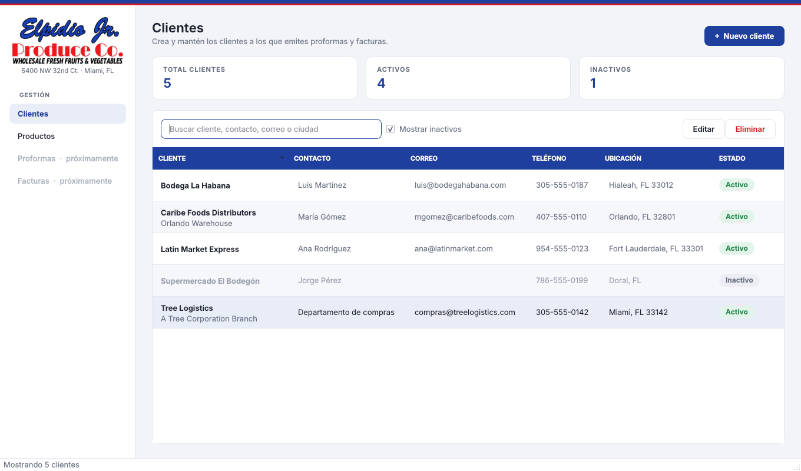
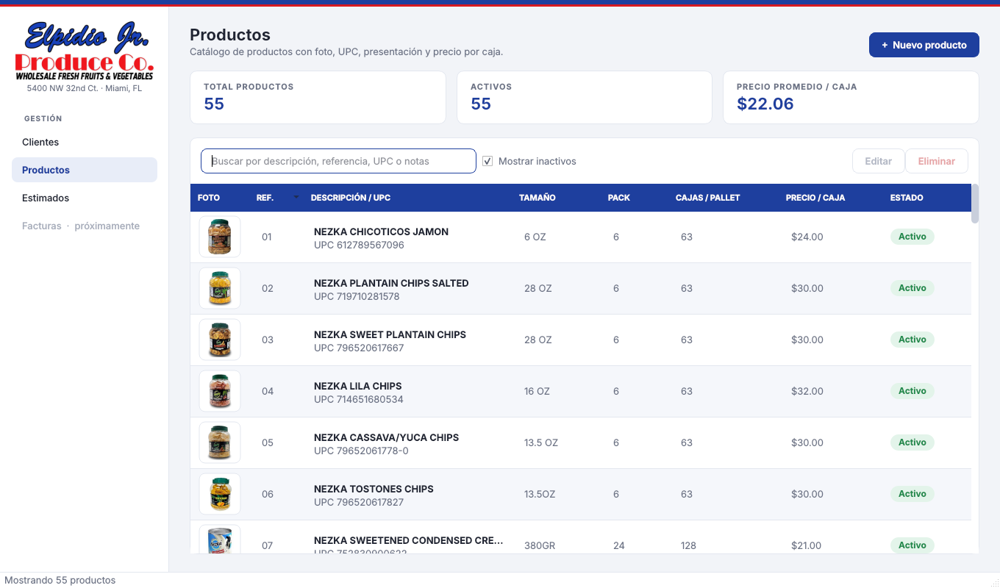
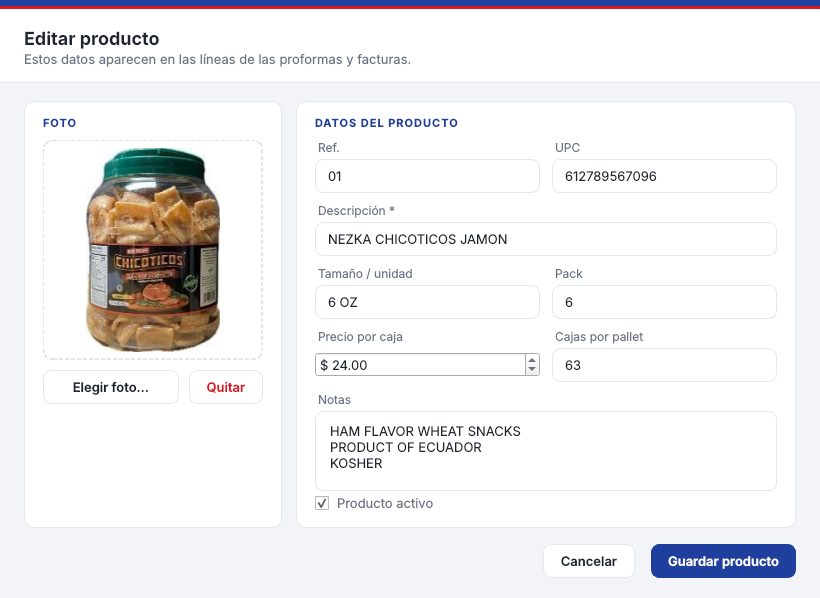
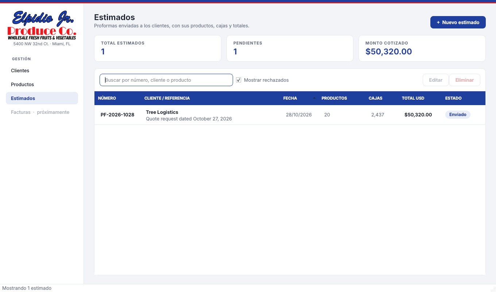
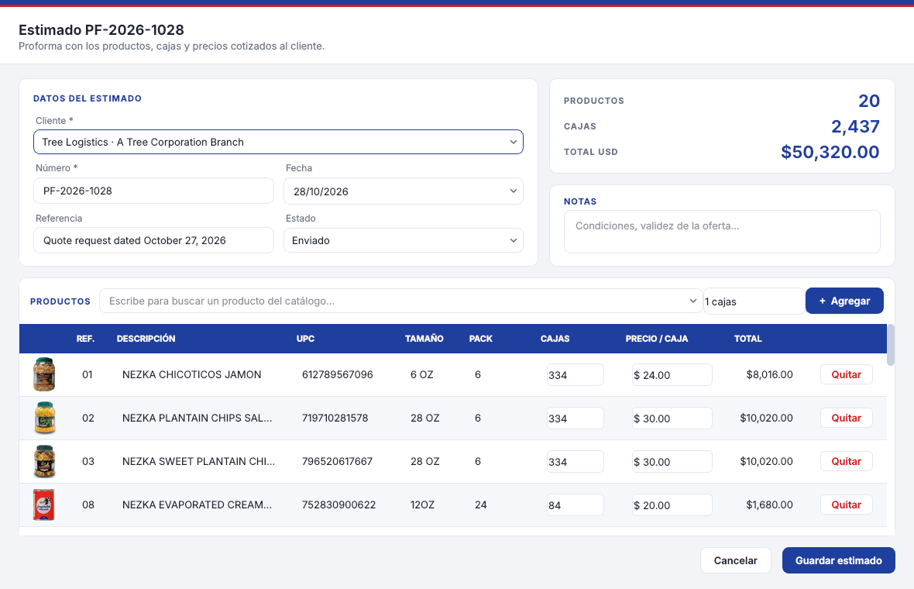
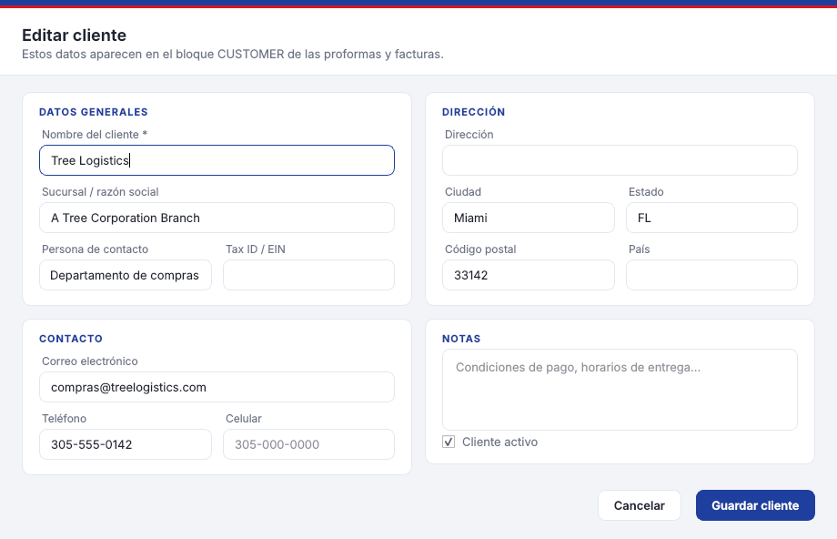

# Nezka Invoice

Aplicación de escritorio de **Elpidio Jr. Produce Co.** para gestionar clientes, el catálogo de productos y los estimados (proformas).

Hecha en Python con [PySide6](https://doc.qt.io/qtforpython-6/) (Qt) para la interfaz y SQLite para guardar los datos en un archivo local, sin servidor. Funciona en Windows, macOS y Linux. El diseño usa la identidad de la proforma: logo, azul `#1e3f9e`, franja roja `#d7191f` y tablas con encabezado azul.



## Qué hace

- **Crear clientes** con nombre, sucursal o razón social, contacto, correo, teléfonos, dirección, Tax ID y notas.
- **Mantener los existentes**: editar (doble clic o botón *Editar*), marcar como inactivo o eliminar.
- **Buscar** por nombre, contacto, correo, teléfono, ciudad o Tax ID, y ordenar por cualquier columna.
- Avisa si el nombre ya existe y valida el formato del correo.

### Productos

- La app trae precargados los **55 productos del catálogo** (`Productos.pdf`) con su foto, UPC, tamaño, pack, cajas por pallet, precio por caja y notas (origen, kosher…). Las referencias (01, 02, …) son el orden del catálogo, las mismas que usan las proformas.
- Se cargan una sola vez, al crear la base de datos; después se pueden editar, desactivar o eliminar sin que vuelvan a aparecer.
- **Agregar productos** con *Nuevo producto*: la referencia siguiente se sugiere sola y la foto se elige desde el disco (se reduce a 600 px y se guarda dentro de la base de datos).





### Estimados (proformas)

- La app trae cargado el cliente **Tree Logistics** con su estimado **PF-2026-1028** (20 productos, 2,437 cajas, $50,320.00), igual que la proforma.
- Cada estimado tiene número (serie `PF-año-NNNN`, se sugiere el siguiente), cliente, fecha, referencia, estado (Borrador, Enviado, Aceptado, Rechazado) y notas.
- Los productos se agregan buscándolos en el catálogo; las cajas y el precio por caja se editan en la tabla y los totales se recalculan solos. El estimado guarda una copia de los datos del producto, así que no cambia si luego se edita el catálogo.
- Un cliente con estimados no se puede eliminar (se puede marcar inactivo).





Atajos (en cada pantalla): `Ctrl+N` nuevo cliente o producto, `Ctrl+F` buscar, `Supr` eliminar el seleccionado.



## Descargar para Windows

**[Descargar NezkaInvoice.exe](https://github.com/rcorzogutierrez/nezka-invoice/releases/latest/download/NezkaInvoice.exe)**

Es un único archivo: se abre con doble clic y no necesita instalar Python ni nada más. Como el ejecutable no está firmado, la primera vez Windows puede mostrar "Windows protegió su PC"; se abre con *Más información* → *Ejecutar de todas formas*.

El `.exe` lo genera GitHub Actions (`.github/workflows/windows.yml`) en una máquina Windows:

- Cada cambio que entra en `main` actualiza la versión **ultima** en [Releases](https://github.com/rcorzogutierrez/nezka-invoice/releases), que es la que descarga el enlace de arriba.
- Para entregar una versión fija, se crea una etiqueta (`git tag v1.0.0 && git push origin v1.0.0`) y queda su propia release con el `.exe`.
- En cada pull request el `.exe` queda como *artifact* del workflow para probarlo antes de unirlo.

## Instalar y ejecutar

Requiere Python 3.10 o superior.

```bash
python -m venv .venv
# Windows: .venv\Scripts\activate    macOS/Linux: source .venv/bin/activate
pip install -r requirements.txt
python -m nezka_invoice
```

## Dónde se guardan los datos

En un archivo `nezka.db` dentro de la carpeta de datos del usuario:

| Sistema | Ruta |
|---|---|
| Windows | `%APPDATA%\Elpidio Jr. Produce Co\Nezka Invoice\nezka.db` |
| macOS | `~/Library/Application Support/Elpidio Jr. Produce Co/Nezka Invoice/nezka.db` |
| Linux | `~/.local/share/Elpidio Jr. Produce Co/Nezka Invoice/nezka.db` |

Clientes, productos, fotos y estimados van en ese único archivo, así que para respaldar basta copiarlo. La variable de entorno `NEZKA_DB` permite usar otra ruta.

## Generar el ejecutable a mano

Normalmente no hace falta (ver *Descargar para Windows*), pero se puede generar localmente:

```bash
pip install pyinstaller pillow
pyinstaller --name NezkaInvoice --windowed --onefile -p . --icon nezka_invoice/assets/logo.png \
  --add-data "nezka_invoice/assets:nezka_invoice/assets" nezka_invoice/__main__.py
```

En Windows el separador de `--add-data` es `;` en lugar de `:`. El ejecutable queda en `dist/`. Hay que generarlo en el mismo sistema operativo donde se va a usar (un `.exe` se genera en Windows).

## Actualizar el catálogo incluido

Si cambia `Productos.pdf`, se regenera el catálogo que trae la app (JSON + fotos en `nezka_invoice/assets/products/`):

```bash
pip install -r requirements-dev.txt
python tools/import_catalog.py ruta/a/Productos.pdf
```

Esto solo afecta a instalaciones nuevas; una base de datos existente conserva sus productos.

## Pruebas

```bash
pip install -r requirements-dev.txt
pytest
```
